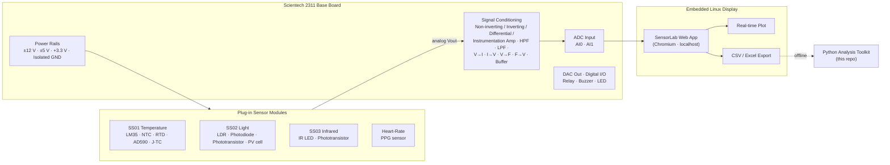
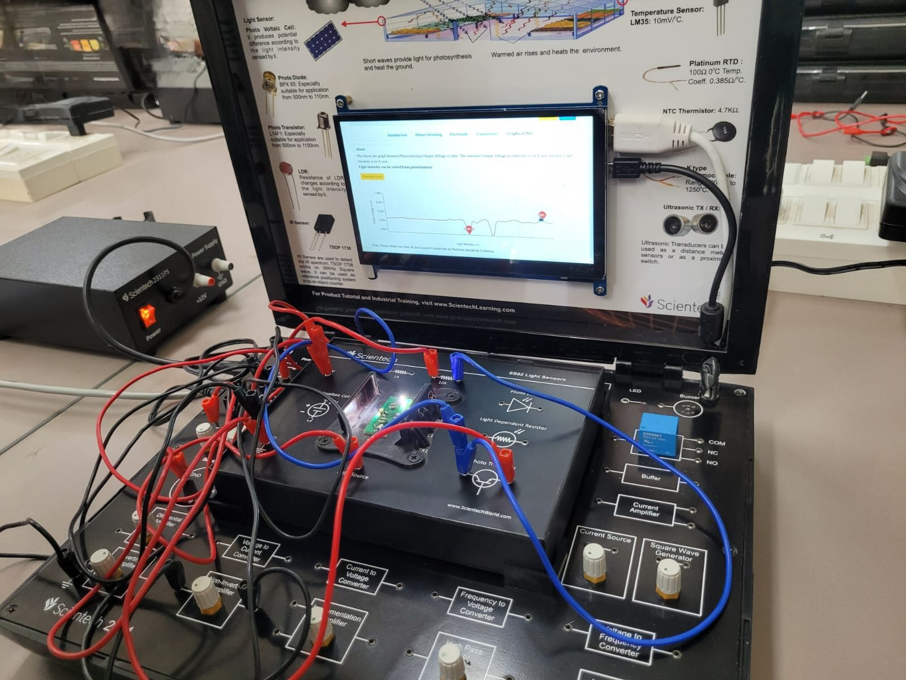

<div align="center">

# Sensor Interfacing & Data Acquisition — Scientech 2311 SensorLab

**Hands-on characterisation of optical, infrared, thermal and biomedical sensors:<br>from transducer physics through analog signal conditioning to ADC capture and live visualisation.**


</div>

---

## Table of Contents

- [Overview](#overview)
- [Objectives](#objectives)
- [Platform Architecture](#platform-architecture)
- [Experiments](#experiments)
- [Key Results](#key-results)
- [Repository Structure](#repository-structure)
- [Analysis Toolkit](#analysis-toolkit)
- [Sensor Reference](#sensor-reference)
- [Skills Demonstrated](#skills-demonstrated)
- [Engineering Notes](#engineering-notes)
- [Acknowledgements](#acknowledgements)
- [License](#license)

---

## Overview

This repository documents a series of **sensor interfacing and data-acquisition (DAQ) experiments** carried out on the **Scientech 2311 SensorLab**. The SensorLab is a modular instrumentation trainer. A base board provides regulated power rails, analog signal-conditioning blocks (amplifiers, filters, V/I and V/F converters) and an ADC front end. Plug-in sensor modules sit on top, and an integrated embedded-Linux display runs the acquisition and plotting software.

Each experiment follows the same instrumentation workflow:

```
Physical quantity → Transducer → Signal conditioning → ADC → Embedded Linux host → Live plot / CSV export → Interpretation
```

Sensors studied: **IR LED + phototransistor (SS03), TSOP1738, LDR, BPX65 photodiode, L14F1 phototransistor, photovoltaic cell (SS02), LM35 and NTC thermistor (SS01)**, and an **optical heart-rate (PPG) sensor**.

> **Session:** July 2025 · **Type:** Educational laboratory project · **Platform:** Scientech 2311 SensorLab

---

## Objectives

1. Understand the **transduction principle** of each sensor (photoconductive, photovoltaic, photo-junction, band-gap temperature, NTC semiconductor and photoplethysmographic).
2. Build the **excitation and biasing circuits** (voltage dividers, pull-up loads, current-limited emitters) from the module schematics.
3. Route sensor outputs through the base board's **signal-conditioning chain**: non-inverting and instrumentation amplifiers and RC filters.
4. Digitise the conditioned signal through the **ADC input (AI0/AI1)** and capture **real-time time-series** data.
5. Plot, export (CSV/Excel) and **interpret sensor behaviour** under changing physical stimuli: light intensity, obstacle distance, temperature and blood-volume pulse.

---

## Platform Architecture



Full block-level description: **[docs/01-platform-architecture.md](docs/01-platform-architecture.md)**

---

## Experiments

| # | Experiment | Module | Sensors / Devices | Measured Quantity | Write-up |
|:-:|------------|:------:|-------------------|-------------------|:--------:|
| 1 | **Temperature Sensing** | SS01 | LM35 (10 mV/°C), NTC thermistor (4.7 kΩ) | Temperature vs time (1 s update rate) | [📄](experiments/01-temperature-sensing/README.md) |
| 2 | **Light Sensing** | SS02 | LDR, BPX65 photodiode, L14F1 phototransistor, PV cell | Output voltage vs light intensity | [📄](experiments/02-light-sensing/README.md) |
| 3 | **Infrared Sensing** | SS03 | IR LED (R = 500 Ω), phototransistor (10 kΩ load), TSOP1738 | Phototransistor Vout vs time and distance | [📄](experiments/03-infrared-sensing/README.md) |
| 4 | **Heart-Rate Monitoring** | Add-on | Optical PPG heart-rate sensor | Pulse waveform (mV) vs time | [📄](experiments/04-heart-rate-monitoring/README.md) |

<table>
  <tr>
    <td align="center"><br><sub>SS01 Temperature</sub></td>
    <td align="center"><br><sub>SS02 Light Sensors</sub></td>
    <td align="center"><br><sub>SS03 Infrared</sub></td>
    <td align="center"><br><sub>Heart-Rate (PPG)</sub></td>
  </tr>
</table>

---

## Key Results

| Experiment | Observation (read from the on-device plots) | Engineering takeaway |
|------------|---------------------------------------------|----------------------|
| **LM35** | Temperature rose from **35.8 °C to a peak of 37.4 °C** under applied heat, then settled near 37 °C (≈ 358 mV → 374 mV at 10 mV/°C). | The linear 10 mV/°C output needs no linearisation, only a gain stage to use the ADC's full span. |
| **IR (SS03)** | Conditioned phototransistor output swung between **≈ 1.72 V (peak) and 0 V** as the IR LED–phototransistor distance changed, giving repeatable plateau and dip transitions. | Usable as a binary obstacle/edge detector; the transition band sets a practical detection-distance threshold. |
| **Light (SS02)** | Phototransistor output stayed stable at constant illumination and dropped sharply when the potentiometer-controlled light source was varied. | The phototransistor's high gain gives fast, high-contrast response. The LDR is slower and logarithmic. |
| **Heart rate** | PPG output showed sharp excursions up to **≈ 3.5 V** (clipping near 4 V), relaxing to a **≈ 0.5–0.65 V baseline** with low-amplitude ripple over a 160 s capture. | Finger placement and motion dominate the raw signal. A **0.5–4 Hz band-pass** and peak detection are needed to extract BPM (see toolkit). |

Detailed per-experiment observations, calculations and error sources are in each write-up.

---

## Repository Structure

```
scientech-2311-sensor-interfacing-lab/
├── README.md                          ← You are here
├── LICENSE                            ← MIT (source code)
├── LICENSE-docs                       ← CC BY 4.0 (documentation & photographs)
├── .gitignore
├── .gitattributes
├── .github/
│   └── workflows/
│       └── ci.yml                     ← Runs the analysis toolkit's unit tests
│
├── docs/
│   ├── 01-platform-architecture.md    ← Base board, power rails, conditioning blocks, DAQ host
│   ├── 02-signal-conditioning.md      ← Amplifier, filter and ADC design equations
│   ├── 03-sensor-reference.md         ← Datasheet-level parameters of every sensor used
│   └── 04-lab-methodology.md          ← Procedure, safety, calibration and error analysis
│
├── experiments/
│   ├── 01-temperature-sensing/README.md
│   ├── 02-light-sensing/README.md
│   ├── 03-infrared-sensing/README.md
│   └── 04-heart-rate-monitoring/README.md
│
├── analysis/                          ← Python toolkit for exported SensorLab CSVs
│   ├── README.md
│   ├── requirements.txt
│   ├── pytest.ini
│   ├── sensorlab/
│   │   ├── __init__.py
│   │   ├── models.py                  ← Sensor transfer functions (LM35, NTC, PT100, dividers, ADC)
│   │   ├── capture.py                 ← Robust loader for SensorLab CSV/Excel exports
│   │   └── signal.py                  ← Filtering, peak detection, BPM estimation
│   ├── plot_capture.py                ← CLI: plot a capture with optional unit conversion
│   ├── heart_rate.py                  ← CLI: estimate BPM from a PPG capture
│   └── tests/
│       ├── test_models.py
│       └── test_signal.py
│
├── data/
│   ├── README.md                      ← Naming convention and capture metadata
│   ├── raw/                           ← Untouched SensorLab CSV exports
│   └── processed/                     ← Derived results (git-ignored)
│
└── assets/
    └── images/
        ├── temperature/               ← SS01 setup, LM35 plot, theory, circuits
        ├── light/                     ← SS02 setup, wiring, module close-up
        ├── infrared/                  ← SS03 setup, plot, connections, theory
        └── heart-rate/                ← PPG setup and waveform
```

---

## Analysis Toolkit

The `analysis/` package reproduces the lab's calculations offline from the **CSV/Excel files exported by the SensorLab software** (`Download Excel` button).

```bash
cd analysis
python -m pip install -r requirements.txt

# Plot an LM35 capture and convert volts → °C
python plot_capture.py ../data/raw/lm35_capture.csv --convert lm35 --units V -o lm35.png

# Estimate heart rate from a PPG capture
python heart_rate.py ../data/raw/ppg_capture.csv --units mV --plot ppg.png

# Run the unit tests
python -m pytest
```

| Module | Provides |
|--------|----------|
| `sensorlab.models` | LM35 V↔°C, NTC β-model and Steinhart–Hart, PT100 Callendar–Van Dusen, voltage-divider inversion (LDR/NTC), op-amp gain, RC cut-off, ADC LSB and code↔voltage |
| `sensorlab.capture` | Column auto-detection, timestamp → elapsed-seconds conversion, sample-rate inference |
| `sensorlab.signal` | Zero-phase Butterworth band-pass, moving average, peak-based BPM estimation with RR-interval statistics |

See **[analysis/README.md](analysis/README.md)** for the API and CLI reference.

---

## Sensor Reference

| Sensor | Principle | Key specification | Output |
|--------|-----------|-------------------|--------|
| **LM35** | Band-gap IC temperature sensor | 10 mV/°C, −55 °C to +150 °C, < 0.1 °C self-heating in still air | Linear voltage |
| **NTC thermistor** | Semiconductor, negative temperature coefficient | R₂₅ = 4.7 kΩ | Non-linear resistance (β / Steinhart–Hart) |
| **Platinum RTD (PT100)** | Metal resistance vs temperature | 100 Ω at 0 °C, 0.385 Ω/°C | Near-linear resistance |
| **K-type thermocouple** | Seebeck effect | −200 °C to +1250 °C | µV-level EMF (needs instrumentation amp) |
| **LDR** | Photoconductive (CdS) | Resistance falls as illumination rises | Resistance (divider → voltage) |
| **BPX65 photodiode** | Photo-junction (PIN) | ≈ 500–1100 nm application range (kit panel), fast response | Photocurrent |
| **L14F1 phototransistor** | Photo-Darlington | ≈ 500–1100 nm application range (kit panel), high gain | Collector current |
| **Photovoltaic cell** | Photovoltaic effect | Self-generating | Open-circuit voltage / short-circuit current |
| **TSOP1738** | IR receiver with band-pass and demodulator | 38 kHz carrier | Active-low digital |
| **PPG heart-rate sensor** | Reflective photoplethysmography | IR emitter and detector | Pulsatile analog voltage |

Full parameters, equations and pinouts: **[docs/03-sensor-reference.md](docs/03-sensor-reference.md)**

---

## Skills Demonstrated

- **Analog front-end design:** biasing, voltage dividers, pull-up loads, LED current limiting.
- **Signal conditioning:** non-inverting and instrumentation amplification, active RC filtering, impedance buffering.
- **Data acquisition:** ADC interfacing, sampling-rate choice, quantisation, common-ground discipline.
- **Sensor characterisation:** transfer functions, linearity, sensitivity, response time, saturation.
- **Embedded Linux tooling:** browser-based acquisition UI, live plotting and CSV export on the device.
- **Data analysis:** Python (NumPy, SciPy, pandas, Matplotlib) for conversion, filtering and feature extraction.
- **Technical documentation:** reproducible procedures, observations and error analysis.

---

## Engineering Notes

- **LM35 conversion erratum:** the on-device breadboard activity page gives `Temperature(°C) = Output Voltage(mV) × 100`. The dimensionally correct relation is **T(°C) = V<sub>out</sub>(V) × 100 = V<sub>out</sub>(mV) / 10**, which is what `sensorlab.models.lm35_voltage_to_celsius` implements.
- **Common ground:** every module page warns that *all ground connections on the platform must be common*. A floating sensor ground appears as offset and noise on the ADC trace.
- **Display clock:** timestamps on the device plots (e.g. `22:20:39`) come from the embedded host's unsynchronised RTC. Use them as relative time only.

---

## Acknowledgements

Thanks to the laboratory mentors and peers who supported these experiments. *Scientech*, *SensorLab* and the module names (SS01, SS02, SS03) belong to **Scientech Technologies Pvt. Ltd.** This repository is an independent educational write-up and is not affiliated with or endorsed by the manufacturer. On-screen theory pages appear in photographs only as documentation of the lab session.

---

## License

- **Source code** (`analysis/`): [MIT License](LICENSE)
- **Documentation and original photographs** (`docs/`, `experiments/`, `assets/`): [CC BY 4.0](LICENSE-docs)

<div align="center"><sub>Educational project · Sensors · IoT · Embedded Systems · Instrumentation</sub></div>
