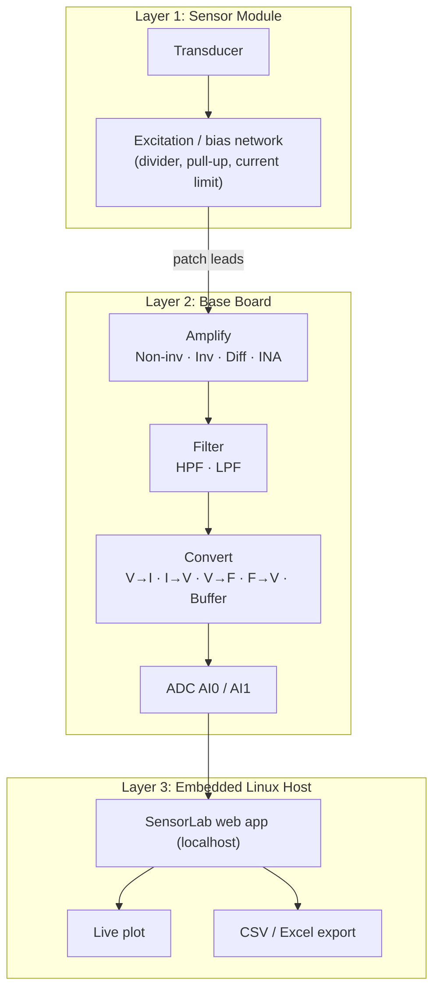

# Platform Architecture: Scientech 2311 SensorLab

The Scientech 2311 is a modular **sensor and instrumentation trainer**. It has three layers:

1. **Plug-in sensor modules (SS-series):** transducers and their local excitation and biasing.
2. **Base board:** power rails, a library of analog signal-conditioning blocks, and DAQ I/O.
3. **Embedded Linux display:** acquisition software, real-time plotting and data export.

  

---

## 1. System Block Diagram

## 2. Base Board: Functional Blocks

All blocks are brought out to 4 mm / 2 mm banana sockets and wired with patch leads. This makes every signal path explicit and probe-able.

### 2.1 Power Supply

| Rail | Typical use |
|------|-------------|
| **+12 V / −12 V** | Op-amp supplies, heater and fan drive, bipolar signals |
| **+5 V / −5 V** | Sensor excitation, logic, bipolar sensor modules |
| **+3.3 V** | Low-voltage logic and reference |
| **Isolated GND** | Common analog reference for every module |

An external **Scientech 2311PS DC power supply** provides the +12 V input.

### 2.2 Signal-Conditioning Blocks

| Block | Function | Typical use in these experiments |
|-------|----------|----------------------------------|
| **Non-inverting amplifier** (gain pot) | Av = 1 + Rf/Rg, high Zin | IR phototransistor output scaling |
| **Inverting amplifier** (gain pot) | Av = −Rf/Rin | Polarity inversion, summing |
| **Differential amplifier** | Av(V2 − V1) | Bridge outputs |
| **Instrumentation amplifier** | High-CMRR differential gain | Thermocouple, RTD and NTC bridges (SS01) |
| **High-pass filter** (pot) | Removes DC and slow drift | PPG baseline removal |
| **Low-pass filter** (pot) | Anti-aliasing, noise reduction | All analog channels |
| **Voltage → current converter** | 4–20 mA style loop drive | Industrial transmitter concept |
| **Current → voltage converter** | Transimpedance | Photodiode photocurrent |
| **Voltage → frequency converter** | Analog-to-pulse-rate | Noise-immune telemetry |
| **Frequency → voltage converter** | Pulse-rate to analog | Tachometry |
| **Buffer** | Unity-gain impedance isolation | Driving the ADC from high-Z sources |
| **Current amplifier / current source** | Constant-current excitation | RTD excitation |
| **Square-wave generator** | Clock and modulation source | IR modulation |
| **Potentiometer** | Adjustable reference / stimulus | Light-source intensity (SS02) |
| **Sensor interface** (GND, VCC, A, B, C) | Generic 5-pin sensor port | External sensors |

### 2.3 Data-Acquisition and I/O

| Port | Description |
|------|-------------|
| **ADC Input (AI0, AI1)** | Analog inputs digitised by the host |
| **DAC Output** | Analog output for actuation and stimulus |
| **Digital Input / Output** | Logic-level I/O |
| **Relay (COM / NC / NO)** | Switched load control (set-point / alarm demos) |
| **Buzzer, LED** | Audible and visual indicators |

## 3. Embedded Linux Host

The lid-mounted HDMI touch display is driven by an **embedded Linux single-board computer**. Its desktop shows a Chromium browser, a file manager, a terminal and VNC. Acquisition runs as a **local web application**:

| Item | Detail |
|------|--------|
| Server | `localhost/sensorlab/*.php` (one page per sensor, e.g. `sslm.php` LM35, `therm.php` NTC, `infra_d.php` IR) |
| Navigation | *Home → Analog Sensors → Displacement Sensors → Infrared Sensor SS03* |
| Page tabs | **Introduction · Theory/Working · Pin Details · Connections · Graphical Plot** |
| Plotting | Real-time time-series with min/max markers, update rate 1 s on temperature pages |
| Export | **Download Excel** → `data.csv` |
| Heart-rate view | Dedicated *Scientech-SensorLab* plotting app: *Heart Rate Output vs Time*, cursor read-out (X s, Y mV), *Stop / USB On / Set Point* controls |

> **Note:** the host's real-time clock was not network-synchronised, so plot timestamps (e.g. `22:20:39`) are only meaningful as relative time.

## 4. Sensor Modules Used

| Module | Contents |
|--------|----------|
| **SS01 Temperature Sensors** | Heater block, fan (SW1), LM35_Hot, LM35_Cold, AD590, NTC, RTD, J-type thermocouple, instrumentation amplifier with gain pot, 1 kΩ / 10 kΩ |
| **SS02 Light Sensors** | Photovoltaic cell, photodiode (D1), LDR (L1), phototransistor (TR1), shrouded light source, 1 kΩ / 10 kΩ |
| **SS03 IR Sensor** | IR LED, phototransistor, slotted and reflective holder, TSOP reference |
| **Heart-Rate Sensor** | Optical PPG front end with ±5 V supply and an analog OUT pin |

## 5. Grounding Rule

Every module page carries the same note: **all ground connections on the platform must be common.** The base board, the module and the ADC must share one reference (*Isolated GND*). A missing ground link shows up as DC offset, a floating or noisy trace, or mains hum on the plot.
