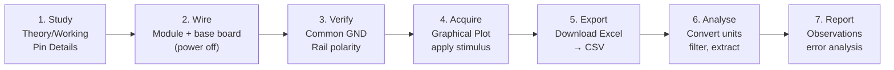

# Lab Methodology

A common workflow was used for every experiment so that results are comparable and reproducible.

---

## 1. Standard Workflow

## 2. Pre-Power Checklist

| Check | Why |
|-------|-----|
| Platform powered **off** while patching | Prevents shorts between rails during wiring |
| Rail polarity matches module markings (±12 V, ±5 V, +3.3 V) | Reverse supply destroys op-amps and ICs |
| **Common ground** between module, base board and ADC | Floating ground gives offset, noise and hum |
| Gain pots at **minimum** before power-up | Avoids saturating the ADC on the first sample |
| Sensor output → conditioning → ADC path traced end to end | Confirms the signal actually reaches AI0/AI1 |

## 3. Stimulus Methods

| Experiment | Stimulus | Control |
|------------|----------|---------|
| Temperature | Heater block / soldering iron (no direct contact with the IC), fan for cooling | SW1 fan switch |
| Light | On-module light source | Base-board potentiometer |
| Infrared | Distance between emitter and detector, or an obstacle | Manual, repeated near → far → near |
| Heart rate | Fingertip on the sensor | Steady, light contact |

## 4. Data Handling

1. Export every capture with **Download Excel** right after acquisition.
2. Rename it descriptively: `YYYYMMDD_<experiment>_<condition>.csv` (e.g. `20250717_lm35_heating.csv`).
3. Write down the **gain settings and load resistor values** used, since they are needed to convert volts back to physical units.
4. Store raw exports under [`data/raw/`](../data/README.md). Never edit raw files; write derived results to `data/processed/`.

## 5. Error Analysis Framework

Each write-up groups errors into:

| Category | Examples |
|----------|----------|
| **Sensor** | Tolerance (β, R25), non-linearity, self-heating, hysteresis, dark current |
| **Circuit** | Divider loading, amplifier offset and gain error, saturation |
| **Environmental** | Ambient light and IR, air currents, mains interference, motion |
| **Acquisition** | Quantisation, aliasing, insufficient sample rate, clock offset |
| **Procedural** | Misalignment, inconsistent stimulus, settling time not respected |

## 6. Safety

- The heater block and soldering iron reach **burn-hazard temperatures**. Keep them clear of patch leads and do not touch sensor bodies directly with the iron.
- Do not exceed module voltage ratings. Use the base-board rails only.
- Switch off the platform before changing modules.
- The PPG sensor is for **educational demonstration only** and is not a medical device.
