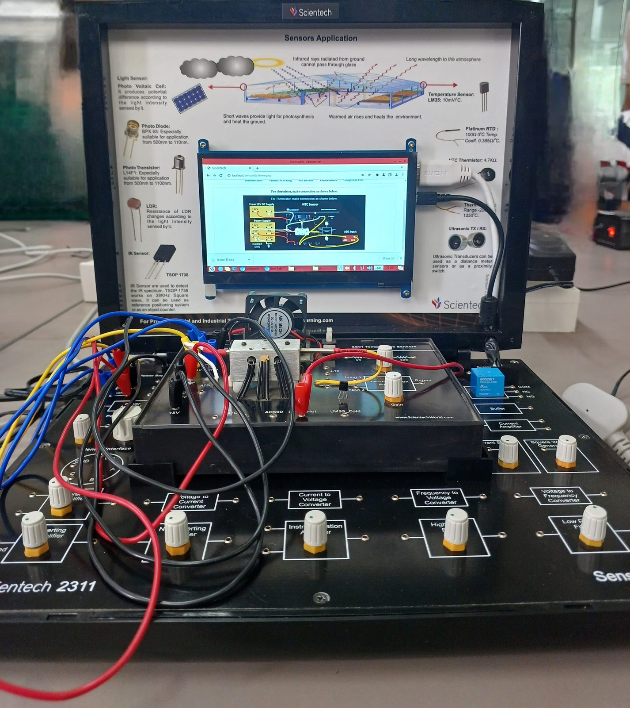
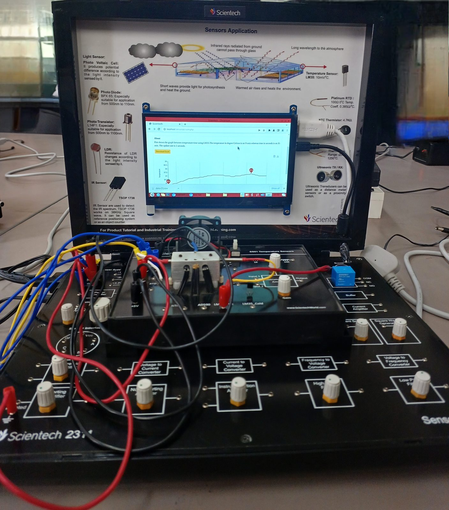
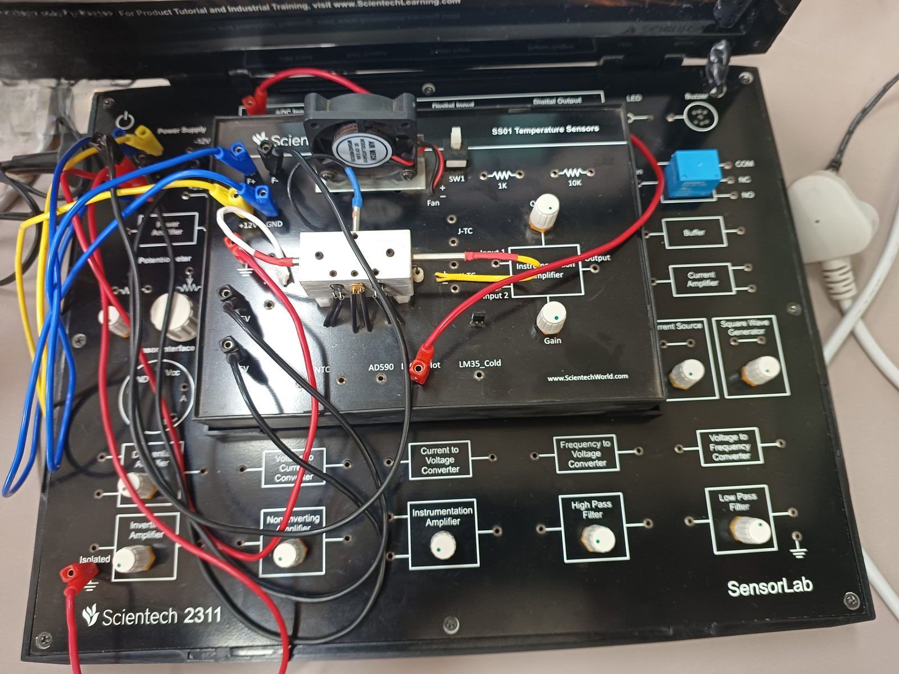
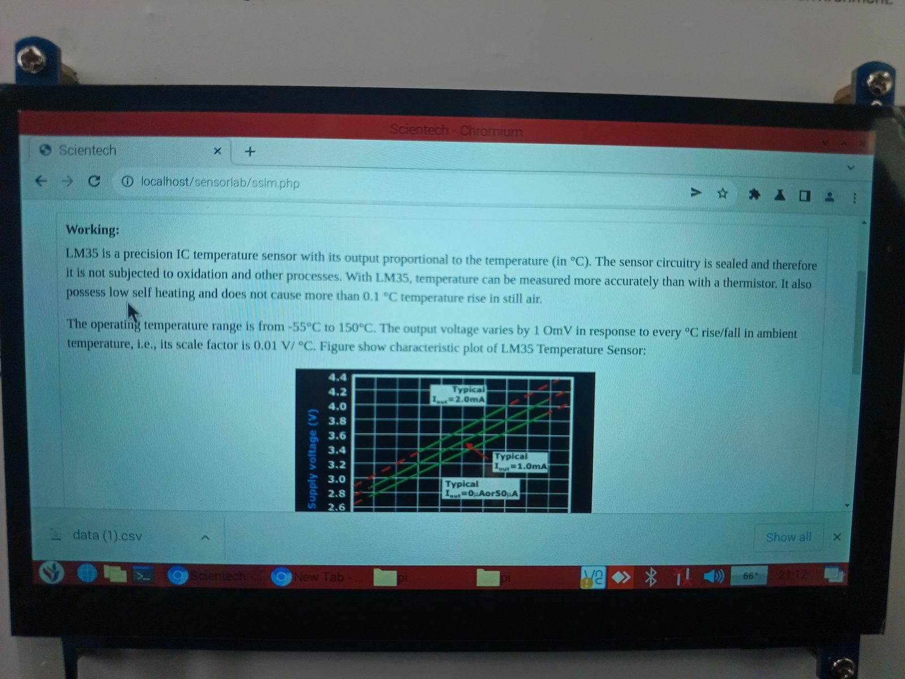
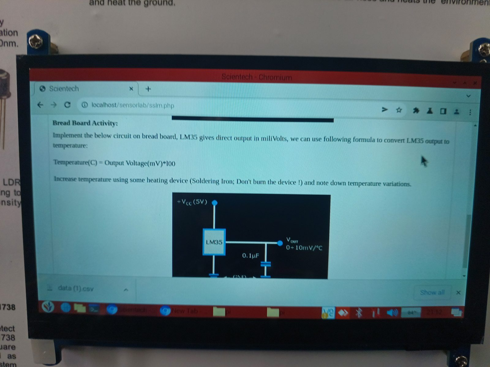
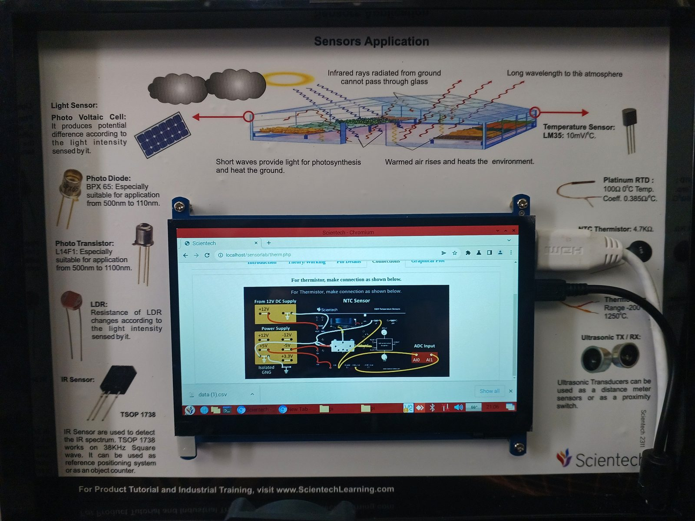

# Experiment 01: Temperature Sensing (SS01 Module)

> **Sensors:** LM35 precision IC sensor · NTC thermistor (4.7 kΩ)<br>
> **Also on the module:** PT100 RTD · AD590 · J-type thermocouple · heater block with cooling fan · instrumentation amplifier<br>
> **Acquisition:** SensorLab web app (`localhost/sensorlab/sslm.php`, `therm.php`), 1 s update rate, CSV export

<p align="center">
  
  
</p>

---

## 1. Objective

- Characterise the **LM35** linear temperature sensor and convert its output voltage to °C.
- Interface the **NTC thermistor** through a resistive divider and observe its non-linear, negative-coefficient response.
- Capture temperature against time while heat is applied, and export the data set for offline analysis.

## 2. Module Overview: SS01 Temperature Sensors

| Element | Purpose |
|---------|---------|
| **Aluminium heater block** | Holds the LM35 (hot side), AD590, NTC, RTD and thermocouple junction at a common temperature |
| **Fan (via SW1)** | Forced-air cooling of the block for heat and cool cycles |
| **LM35_Hot / LM35_Cold** | Sensor in the heater block and an ambient reference sensor (used for thermocouple cold-junction compensation) |
| **J-TC** | J-type thermocouple input |
| **Instrumentation amplifier (Gain pot)** | Differential µV/mV amplification for thermocouple and bridge signals |
| **1 kΩ / 10 kΩ resistors** | Divider and bias resistors for the resistive sensors |

<p align="center">
  
</p>

## 3. Theory

### 3.1 LM35

The LM35 is a band-gap temperature sensor whose output is **directly proportional to temperature in °C**:

$$V_{out} = 10\ \text{mV/°C} \times T \quad\Longrightarrow\quad T(°C) = \frac{V_{out}(\text{mV})}{10} = V_{out}(\text{V}) \times 100$$

| Parameter | Value |
|-----------|-------|
| Scale factor | 10 mV/°C (0.01 V/°C) |
| Operating range | −55 °C to +150 °C |
| Self-heating | < 0.1 °C in still air |
| Package | Sealed TO-92: no oxidation, more accurate than a bare thermistor |

<p align="center">
  
</p>

> ⚠️ **Erratum in the on-device material.** The breadboard activity page states
> `Temperature(C) = Output Voltage(mV) * 100`, which is dimensionally wrong (36 °C would
> imply 0.36 mV). The correct relation is **T = V<sub>out</sub>(mV) / 10**.

### 3.2 NTC Thermistor

An NTC thermistor's resistance falls exponentially with temperature. The **β-model** is:

$$R(T) = R_{25}\, e^{\beta\left(\frac{1}{T} - \frac{1}{T_{25}}\right)}, \qquad R_{25} = 4.7\ \text{k}\Omega$$

For better accuracy over a wide range, the **Steinhart–Hart** equation fits three calibration points:

$$\frac{1}{T} = A + B\ln R + C(\ln R)^3$$

In a divider with the thermistor on the low side, $V_{out} = V_{in}\,\dfrac{R_{NTC}}{R_{NTC}+R_{fixed}}$, so the measured voltage falls as temperature rises.

## 4. Circuit and Connections

**LM35 breadboard circuit:** +V<sub>CC</sub> (5 V) → LM35 → V<sub>out</sub> (0 + 10 mV/°C), with a **0.1 µF decoupling capacitor** from output to GND to suppress noise pickup on the high-impedance line.

<p align="center">
  
</p>

**NTC thermistor platform wiring** (from the module's *Connections* tab):

1. **+12 V DC supply** feeds the heater and fan circuit.
2. **+5 V** and **isolated GND** from the base-board power block feed the sensor divider.
3. The sensor output is routed through the **instrumentation amplifier** to the **ADC input (AI0 / AI1)**.
4. **All grounds are tied together** to a common reference.

<p align="center">
  
</p>

## 5. Procedure

1. Power off the platform, then seat the SS01 module on the base board.
2. Make the connections for the selected sensor as shown above. Verify a common ground.
3. Power on and open the sensor page in the SensorLab app. Read *Theory/Working* and *Pin Details*.
4. Open *Graphical Plot* and start acquisition (1 s update rate).
5. Apply heat to the sensor block (heater or soldering iron, **without touching the device body**) and observe the trace.
6. Switch on the fan (SW1) to observe the cooling response.
7. Click **Download Excel** to export the capture as CSV.

## 6. Observations

| Quantity | Value (read from the on-device plot) |
|----------|--------------------------------------|
| Initial temperature | **35.8 °C** (≈ 358 mV) |
| Peak temperature | **37.4 °C** (≈ 374 mV) |
| Steady-state after peak | ≈ **37.0 °C** |
| Rise | ≈ **1.6 °C** (≈ 16 mV at the sensor) |
| Update rate | 1 sample/s |
| Response shape | Smooth, monotonic rise with small step quantisation, mild overshoot, then plateau |

## 7. Analysis

- **Linearity:** with a 10 mV/°C slope and no offset, converting the LM35 output is a single multiplication. No look-up table or polynomial is needed (unlike the NTC).
- **Resolution budget:** a 1.6 °C change is only 16 mV. Without gain, an ADC with a ~1 mV LSB resolves ~0.1 °C. A **non-inverting gain stage** (e.g. A<sub>v</sub> = 1 + R<sub>f</sub>/R<sub>g</sub> ≈ 10) maps the useful 0–50 °C span onto most of the ADC input range and improves effective resolution tenfold.
- **Thermal lag:** the gradual rise and slight overshoot reflect the thermal mass of the aluminium block and the sensor package. The sensor tracks block temperature, not heater temperature.
- **LM35 vs NTC:** the LM35 is linear and factory-calibrated. The NTC has much higher sensitivity (large ΔR per °C near 25 °C) but needs linearisation (β or Steinhart–Hart) and is affected by divider self-heating.

Offline conversion with the toolkit:

```bash
python analysis/plot_capture.py data/raw/lm35_capture.csv --convert lm35 --units V -o lm35.png
```

## 8. Sources of Error

| Source | Effect | Mitigation |
|--------|--------|------------|
| Thermal contact and lag | Reading lags true block temperature | Allow settling time, use thermal paste |
| Ground offset and noise | DC offset, jitter on the trace | Common ground, 0.1 µF decoupling, short leads |
| Self-heating (NTC divider) | Reads high | Keep divider current low (larger R<sub>fixed</sub>) |
| ADC quantisation | Visible step in the plot at small ΔT | Add gain before the ADC, average samples |
| β tolerance (NTC) | Systematic error away from 25 °C | Three-point Steinhart–Hart calibration |

## 9. Conclusion

The LM35 gave a clean, linear temperature response that tracked a 35.8 → 37.4 °C heating event at 1 s resolution. The experiment showed the full chain from transducer to signal conditioning, ADC, live plot and CSV export. It also showed the trade-off between a linear, calibrated IC sensor (LM35) and a high-sensitivity, non-linear one (NTC).
