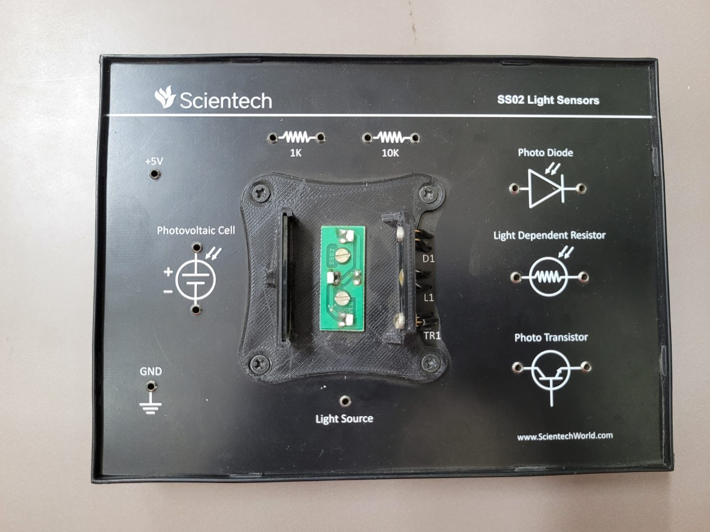
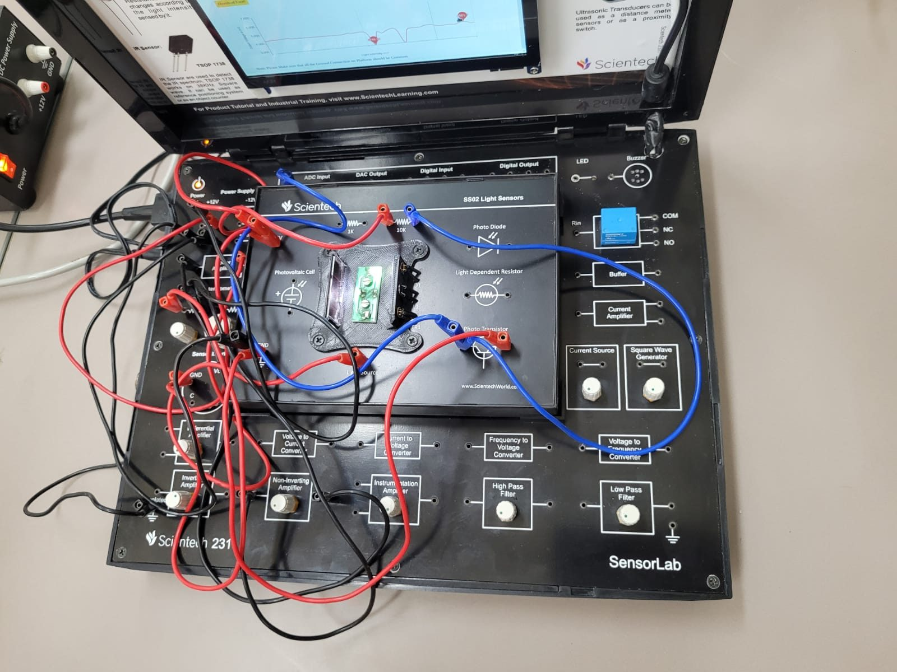

# Experiment 02: Light Sensing (SS02 Module)

> **Sensors:** Light-dependent resistor (LDR) · BPX65 photodiode · L14F1 phototransistor · photovoltaic cell 
> **Stimulus:** On-module light source, intensity varied with the base-board potentiometer 
> **Acquisition:** SensorLab web app → *Graphical Plot* → CSV export

  
  

---

## 1. Objective

- Compare four optical transduction mechanisms: **photoconductive, photo-junction, phototransistor and photovoltaic**.
- Measure sensor output voltage while the light intensity is varied.
- Relate each sensor's response speed, sensitivity and linearity to its physics.

## 2. Module Overview: SS02 Light Sensors

| Element | Notes |
|---------|-------|
| **Photovoltaic cell** | Self-generating source (+/− terminals). No bias needed |
| **Photodiode (D1)** | Reverse-biased photo-junction, photocurrent ∝ irradiance |
| **LDR (L1)** | CdS photoconductor, resistance falls as light increases |
| **Phototransistor (TR1)** | Light acts as base current, amplified by hFE |
| **Light source** | Enclosed emitter facing D1, L1 and TR1 inside a shrouded holder to exclude ambient light |
| **1 kΩ, 10 kΩ** | Load and divider resistors |
| **+5 V, GND** | Excitation |

  

## 3. Theory

### 3.1 LDR (Photoconductive)

Photon absorption creates electron–hole pairs in CdS, raising conductivity. The resistance roughly follows a power law in illuminance:

$$R_{LDR} \approx R_{1}\,E^{-\gamma}, \qquad \gamma \approx 0.6\text{–}0.9$$

In a divider $V_{out} = V_{in}\dfrac{R_{fixed}}{R_{LDR} + R_{fixed}}$ (LDR on top), the output **rises with light**. LDRs are slow: rise and decay take tens of milliseconds.

### 3.2 Photodiode: BPX65

A PIN junction operated **reverse-biased (photoconductive mode)**. Photocurrent $I_p = R_\lambda \cdot P_{opt}$ is linear in optical power over many decades. Dropping it across a load gives $V = I_p R_L$. The kit panel lists an application range of ≈ 500–1100 nm. The device is the fastest of the four (ns-scale).

### 3.3 Phototransistor: L14F1

A photo-Darlington: light-generated base current is multiplied by the transistor gain, $I_C \approx h_{FE}\, I_p$. It gives very high sensitivity, but is slower and less linear than a photodiode and saturates at high illumination. With a pull-up load, $V_{out} = V_{CC} - I_C R_L$.

### 3.4 Photovoltaic Cell

Operated unbiased, the cell produces an open-circuit voltage $V_{oc} \approx \dfrac{nkT}{q}\ln\!\left(\dfrac{I_L}{I_0}+1\right)$. This is **logarithmic** in irradiance, while short-circuit current is linear.

### 3.5 Comparison

| Sensor | Mechanism | Sensitivity | Speed | Linearity | Bias |
|--------|-----------|:-----------:|:-----:|:---------:|:----:|
| LDR | Photoconductive | High | Slow (ms) | Power-law | Divider |
| Photodiode | Photo-junction | Low (needs TIA/gain) | Very fast (ns) | Excellent | Reverse |
| Phototransistor | Photo-junction + gain | Very high | Medium (µs) | Moderate | Collector load |
| PV cell | Photovoltaic | Medium | Medium | Log (Voc) / linear (Isc) | None |

## 4. Procedure

1. Seat the SS02 module and connect **+5 V** and **GND** from the power block.
2. Wire the selected sensor with its load (1 kΩ or 10 kΩ) to form a divider. Take the output to the base-board signal-conditioning input, then the **ADC input**.
3. Connect the **light source** to the **potentiometer** output so the intensity can be swept.
4. Start the *Graphical Plot*, then sweep the potentiometer slowly from minimum to maximum and back.
5. Repeat for each sensor and export each capture.

## 5. Observations

- The **phototransistor output voltage** held a steady level at constant intensity, and showed sharp, deep dips when the light intensity was changed through the potentiometer.
- Transitions were fast and high-contrast, consistent with the phototransistor's internal current gain.
- The plot was taken with *Light Intensity* on the X-axis and phototransistor output voltage (mV) on the Y-axis, with the on-plot markers showing the minimum and maximum points.

## 6. Analysis

- **Polarity:** with the phototransistor in a pull-up (common-emitter) configuration, more light means more collector current and therefore a **lower** Vout. This explains why increased illumination appears as a dip.
- **Saturation:** at high intensity the transistor saturates (VCE(sat) ≈ 0.1–0.3 V), so the output floors. The useful linear region sits between cut-off and saturation, and RL sets where that window falls.
- **Load selection:** 10 kΩ gives higher sensitivity at low light but saturates sooner. 1 kΩ extends the range at the cost of sensitivity.
- **Optical isolation:** the shrouded holder prevents ambient light from adding a DC offset. Without it, room lighting (including 100 Hz flicker from mains lamps) appears on the trace.

## 7. Sources of Error

| Source | Effect | Mitigation |
|--------|--------|------------|
| Ambient and flicker light | Offset, 100 Hz ripple | Shroud the sensors, low-pass filter |
| LDR memory and hysteresis | Different up and down sweep curves | Sweep slowly, allow settling |
| Phototransistor saturation | Clipped output | Smaller RL or lower intensity |
| Temperature drift (dark current) | Baseline drift | Short sessions, reference measurement |

## 8. Conclusion

All four optical sensors convert light to an electrical quantity, but their physics produces very different behaviour. The **photodiode** is the most linear and fastest. The **phototransistor** gives the largest signal and showed clear, repeatable response to intensity changes. The **LDR** is a simple, sensitive but slow option. The **PV cell** generates its own signal without bias.
