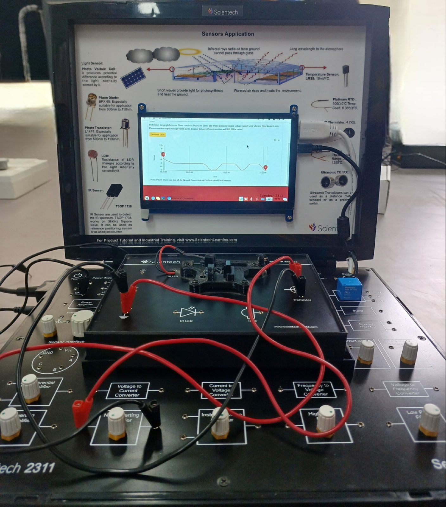
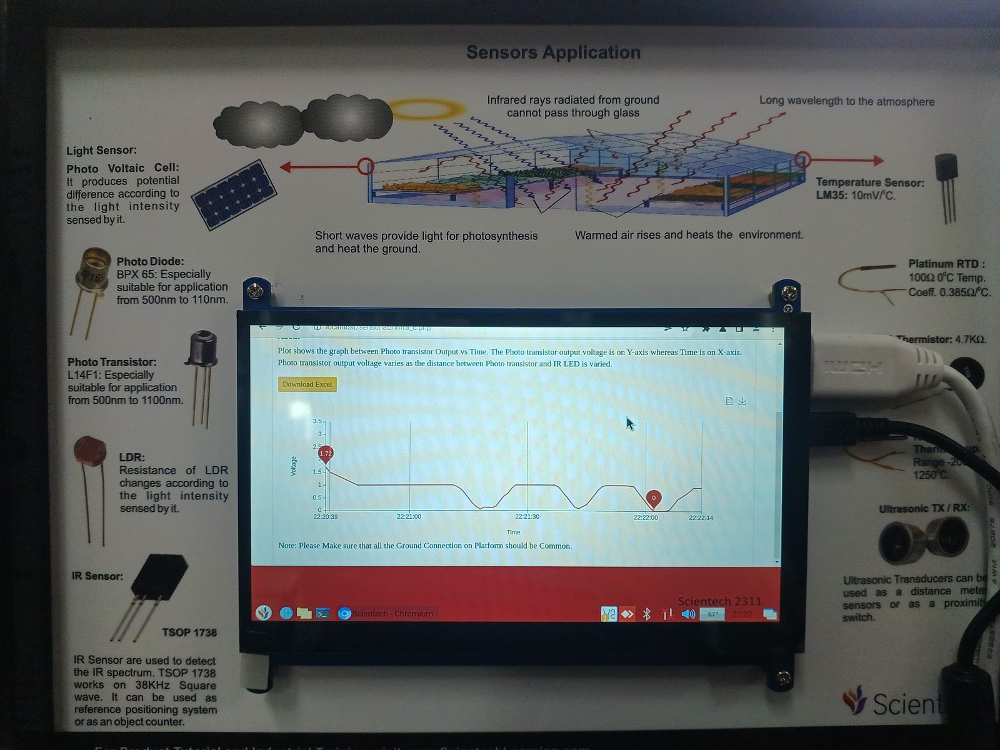
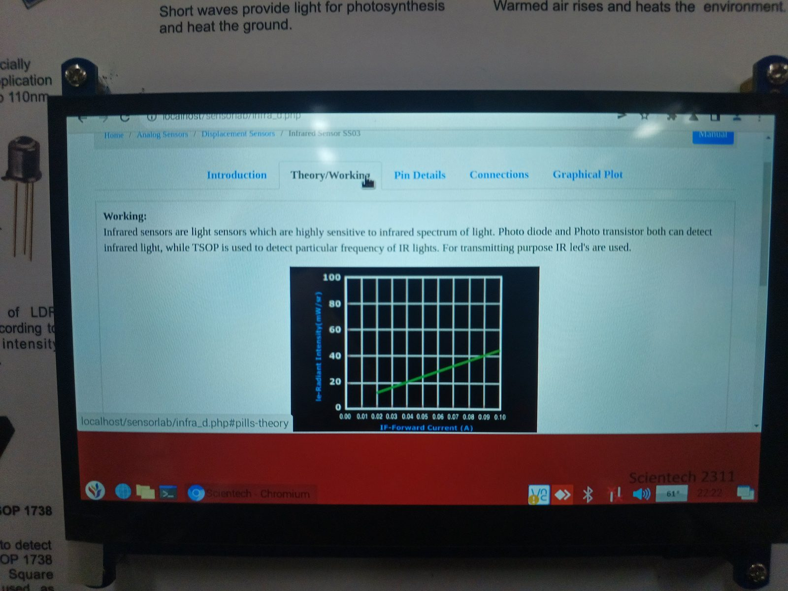
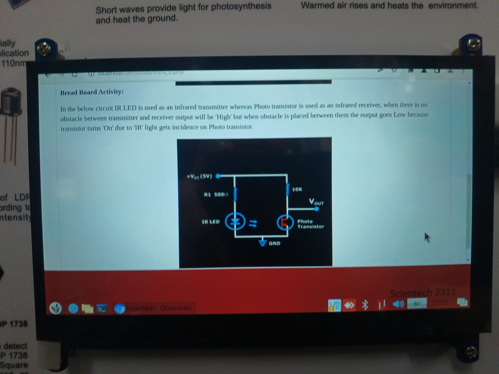
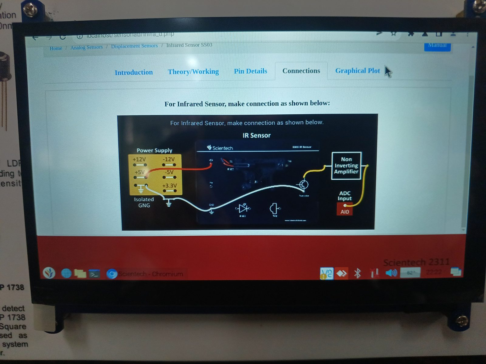

# Experiment 03: Infrared Sensing (SS03 Module)

> **Devices:** IR LED (transmitter) · NPN phototransistor (receiver) · TSOP1738 (38 kHz IR receiver, reference) 
> **Signal chain:** Phototransistor → **Non-inverting amplifier** → **ADC AI0** 
> **Acquisition:** SensorLab web app (`localhost/sensorlab/infra_d.php`, *Analog Sensors → Displacement Sensors → Infrared Sensor SS03*)

  
  

---

## 1. Objective

- Build an **IR transmitter–receiver pair** and use it as a proximity and obstacle detector.
- Measure how the phototransistor output voltage varies with **distance** between the IR LED and the phototransistor.
- Understand the role of carrier-modulated receivers (TSOP1738) in rejecting ambient IR.

## 2. Theory

Infrared sensors are light sensors that are highly sensitive to the IR band (≈ 850–950 nm). Photodiodes and phototransistors both detect IR. A **TSOP** detects IR modulated at one particular carrier frequency. **IR LEDs** are the transmitters.

### 2.1 Emitter

The IR LED's radiant intensity rises **linearly with forward current** IF (≈ 0–100 mA). The series resistor sets the operating point:

$$I_F = \frac{V_{CC} - V_F}{R_1} = \frac{5\ \text{V} - 1.2\ \text{V}}{500\ \Omega} \approx 7.6\ \text{mA}$$

  

### 2.2 Receiver

The phototransistor uses a **10 kΩ pull-up load**. With no IR incident it is cut off and Vout ≈ VCC (**High**). When IR reaches the base region, the transistor turns **On** and pulls Vout **Low**:

$$V_{out} = V_{CC} - I_C R_L,\qquad I_C \propto E_{IR} \propto \frac{1}{d^{2}}$$

Received irradiance falls roughly with the **inverse square of distance**, so Vout is a strongly non-linear function of d. This makes the sensor well suited to threshold (on/off) detection and less suited to precise ranging.

  

### 2.3 TSOP1738

An integrated receiver containing a photodiode, AGC, a **38 kHz band-pass filter** and a demodulator, with an **active-low** digital output. Because it responds only to IR modulated at 38 kHz, it rejects sunlight and lamp IR. This is how TV remotes and reliable object counters work.

## 3. Platform Connections

| From | To | Purpose |
|------|----|---------|
| Power supply **+5 V** | IR LED anode via R1 and phototransistor load | Excitation |
| **Isolated GND** | Module GND | Common reference |
| Phototransistor output | **Non-inverting amplifier** input | Gain and buffering |
| Amplifier output | **ADC Input AI0** | Digitisation |

  

## 4. Procedure

1. Seat the SS03 module. Wire +5 V, GND and the amplifier and ADC path as shown above.
2. Open *Graphical Plot* and start acquisition.
3. Vary the **distance between the IR LED and the phototransistor**, or insert an obstacle, in a repeatable pattern (near → far → near).
4. Observe the plateau and transition behaviour, then export the capture.

## 5. Observations

| Quantity | Value (read from the on-device plot) |
|----------|--------------------------------------|
| Peak conditioned output | **≈ 1.72 V** |
| Minimum output | **0 V** |
| Intermediate plateau | ≈ 1.0 V |
| Capture window | ≈ 95 s (device clock 22:20:39 → 22:22:14) |
| Behaviour | Repeated plateau → dip → recovery cycles as the distance was varied, with smooth ramps between states |

## 6. Analysis

- **Two-state behaviour:** the trace switches between a ≈ 1 V plateau and ≈ 0 V troughs with smooth ramps between them. This is the transfer curve of the phototransistor moving between its active region and saturation as the received IR changes.
- **Repeatability:** the dip-and-recovery cycles have similar depth and shape, so a single comparator threshold (e.g. 0.5 V, with hysteresis) would give a reliable digital obstacle or edge signal.
- **Gain stage:** the non-inverting amplifier scales the phototransistor swing into the ADC range and presents a high input impedance, so the 10 kΩ load is not loaded down.
- **Ambient immunity:** the DC-coupled LED and phototransistor pair responds to any IR source. For outdoor or noisy environments a **modulated** scheme (38 kHz LED drive and TSOP1738) is the robust design.

## 7. Applications

Obstacle avoidance robots · line followers · object and people counters · contactless switches · encoder and slot sensors · IR remote control (with TSOP).

## 8. Sources of Error

| Source | Effect | Mitigation |
|--------|--------|------------|
| Ambient IR (sunlight, lamps) | Raised baseline, false triggers | Shielding, modulated IR + TSOP |
| Misalignment | Lower and variable signal | Fix the geometry, use a collimating tube |
| Surface reflectivity (reflective mode) | Distance reading depends on target colour | Calibrate per target, use as threshold only |
| Inverse-square non-linearity | Poor resolution at long range | Restrict to the near-field detection band |

## 9. Conclusion

The IR LED and phototransistor pair gave a clear, repeatable voltage change (≈ 1.72 V to 0 V) as the distance or obstruction changed, which confirms its use as a proximity and obstacle detector. The experiment also showed why conditioning (non-inverting gain) and modulation (TSOP1738) matter for robust real-world IR sensing.
