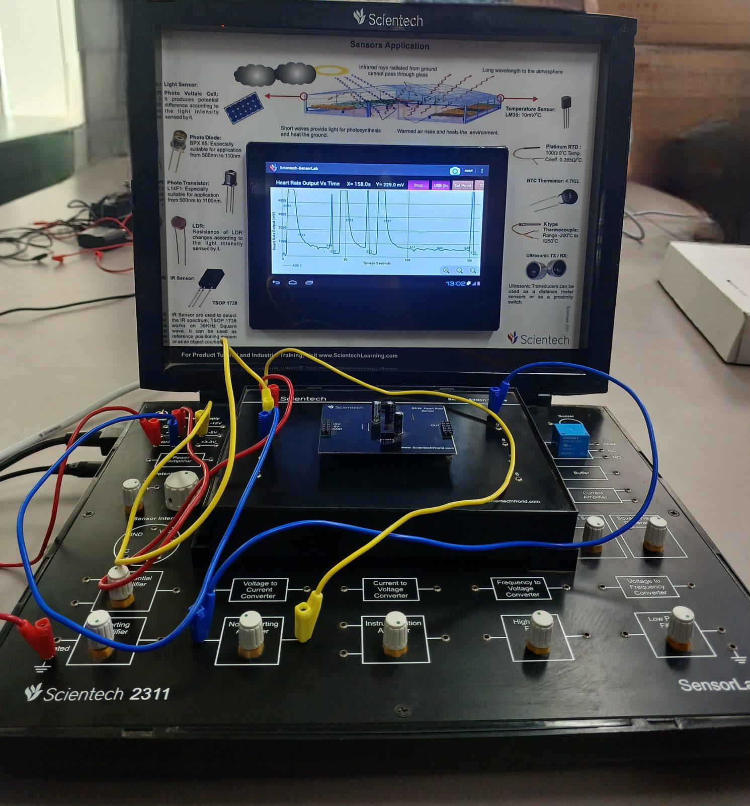
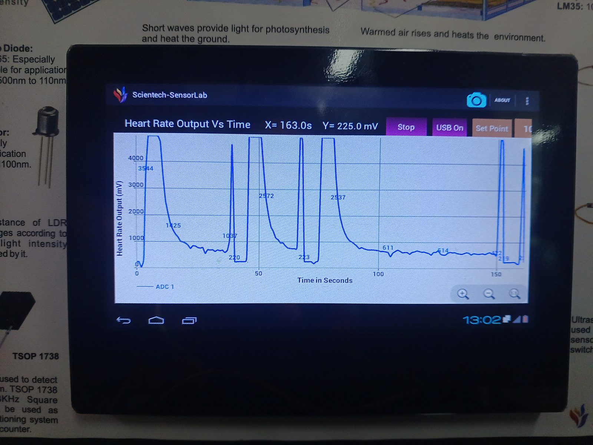

# Experiment 04: Heart-Rate Monitoring (PPG Sensor Add-on)

> **Sensor:** Optical heart-rate sensor add-on module (reflective photoplethysmography)<br>
> **Signal chain:** PPG sensor → base-board conditioning → **ADC 1** → SensorLab plotting app (*Heart Rate Output vs Time*)<br>
> **Capture:** ≈ 160 s, output in mV

<p align="center">
  
  
</p>

---

## 1. Objective

- Acquire a **real-time pulse waveform** from a fingertip using an optical (PPG) sensor.
- Understand how blood-volume changes modulate reflected IR light.
- Identify the signal-processing steps (filtering, peak detection) needed to turn the raw waveform into **beats per minute (BPM)**.

## 2. Theory: Photoplethysmography (PPG)

An IR LED illuminates the fingertip and a photodetector measures the reflected light. With each cardiac cycle, arterial blood volume briefly increases, which **absorbs more light** and modulates the detected signal:

```
              ┌──────── AC component (≈ 0.5–2 % of total): pulsatile arterial blood → heart rate
Detected  ────┤
signal        └──────── DC component: tissue, bone, venous blood, ambient light → baseline
```

| Parameter | Typical value |
|-----------|---------------|
| Pulse band | **0.5–4 Hz** (30–240 BPM) |
| Resting heart rate | 60–100 BPM (1.0–1.7 Hz) |
| AC/DC ratio | ~1 % (requires high gain on the AC part) |
| Dominant interference | Motion artefacts, finger-pressure changes, ambient light, 50 Hz mains |

Heart rate from beat-to-beat (RR) intervals:

$$\text{BPM} = \frac{60}{\overline{RR}\ (\text{s})}$$

## 3. Setup

1. Seat the heart-rate sensor add-on on the base board and connect **+5 V, −5 V and GND** from the power block, as marked on the module.
2. Route the sensor **OUT** through the base-board conditioning blocks to the **ADC input**.
3. Launch the *Heart Rate Output vs Time* view, then place a fingertip gently and steadily on the sensor.
4. Start acquisition (*Stop* / *USB On* / *Set Point* controls on the app toolbar) and record for 2–3 minutes.

## 4. Observations

| Feature (read from the on-device plot) | Value |
|----------------------------------------|-------|
| Capture length | ≈ 160 s (cursor at X = 163.0 s, Y = 225.0 mV) |
| Large excursions | Peaks of **3544 mV, 2572 mV, 2537 mV**, flat-topped near the ≈ 4 V ceiling |
| Post-excursion troughs | ≈ **220 mV** |
| Baseline | ≈ **510–650 mV** (markers 611 mV, 514 mV) with low-amplitude ripple |
| Decay shape | Exponential-like relaxation from each excursion back to baseline over ~10–20 s |

## 5. Analysis

- **Excursions vs beats:** the large, flat-topped excursions (≈ 2.5–3.5 V, clipping near 4 V) come at irregular intervals of tens of seconds. That is far slower than a heartbeat (~1 Hz). They are consistent with **finger placement, pressure changes and motion**, which shift the DC operating point and briefly saturate the gain stage. The slow exponential recovery is the time constant of the AC-coupling and high-pass stage settling.
- **Cardiac component:** the low-amplitude ripple riding on the ≈ 0.5–0.6 V baseline between excursions is where the pulsatile (AC) PPG content lives. At the 160 s full-scale view, individual beats (~0.8 s apart) are compressed into this ripple.
- **What a robust pipeline needs:**
  1. **Band-pass 0.5–4 Hz** to reject baseline wander, motion steps and mains noise.
  2. **Peak detection** with a refractory period (≥ 300 ms for ≤ 200 BPM).
  3. **Median RR interval** to stay robust against a missed or spurious beat.
  4. **Artefact gating:** discard segments where the raw signal clips (≥ ~4 V).
- **Gain trade-off:** high gain is needed for the ~1 % AC component, but it makes the stage saturate during motion. Auto-gain or a DC-restore loop is the usual fix in commercial pulse sensors.

The toolkit implements steps 1–3:

```bash
python analysis/heart_rate.py data/raw/ppg_capture.csv --units mV --plot ppg.png
# → beats detected, BPM, median RR, RR variability (SD)
```

## 6. Sources of Error

| Source | Effect | Mitigation |
|--------|--------|------------|
| Finger motion and pressure | Large steps, saturation | Steady contact, finger clip, artefact gating |
| Ambient light | DC offset, 100 Hz flicker | Shield the sensor, modulated LED drive |
| Cold fingers / low perfusion | Weak AC component | Warm the hand, increase LED current |
| Amplifier saturation | Clipped, unusable segments | Lower gain, DC-restore, auto-gain |

## 7. Conclusion

The experiment captured a live PPG output and exposed the practical challenge of biomedical sensing: the cardiac signal is a small AC component that is easily swamped by motion and contact artefacts. Reliable BPM extraction needs proper conditioning (band-pass filtering, controlled gain) and algorithmic peak detection. These steps are implemented and unit-tested in this repository's analysis toolkit.
